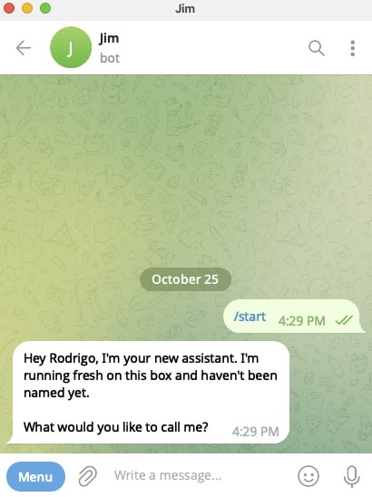

# OpenClaw VPS Deployment

**Deploy a personal OpenClaw agent to a fresh Ubuntu VPS with one command, and message it on Telegram.**

Run `deploy.sh` from your own computer. It connects to the VPS over SSH, installs OpenClaw with the [official installer](https://docs.openclaw.ai/install), connects Claude and your Telegram bot, and starts the agent as a background service. About 10 minutes start to finish.

Tested on Ubuntu 26.04 with OpenClaw 2026.10.

---

## What You Need

- **A Mac or Linux computer** to run the script from (on Windows, use [WSL](https://learn.microsoft.com/windows/wsl/install))
- **A VPS** running Ubuntu (latest LTS), 4 GB RAM, 40 GB disk. We use [OVHcloud](https://www.ovhcloud.com/en/vps/) VPS-1.
- **SSH key login** to the VPS (step 2 below)
- **A Telegram bot token** from [@BotFather](https://t.me/botfather)
- **Your Telegram user ID** from [@userinfobot](https://t.me/userinfobot)
- **Claude access**, either one:
  - an [Anthropic API key](https://platform.claude.com/) (`sk-ant-api...`), or
  - a Claude subscription setup-token: run `claude setup-token` on a machine with Claude Code (`sk-ant-oat...`)

---

## Quick Start

#### 1. Create a VPS

Pick Ubuntu (latest LTS) as the image. Your provider emails you the IP address and login details.

#### 2. Set up SSH key login

Log in once with the password from your provider. Accept the host key fingerprint, and change the password if asked:

```bash
ssh ubuntu@YOUR_VPS_IP
```

Then log out. If you've never made an SSH key on your computer, make one (press Enter at each question):

```bash
ssh-keygen -t ed25519
```

Copy your key to the VPS:

```bash
ssh-copy-id ubuntu@YOUR_VPS_IP
```

`ssh ubuntu@YOUR_VPS_IP` should now log you in without a password. The deploy script needs this, and it turns off password login on the VPS, so this key becomes the only way in.

#### 3. Create a Telegram bot

Message [@BotFather](https://t.me/botfather), send `/newbot`, and follow the prompts. Save the token (looks like `123456789:ABCdef...`).

#### 4. Get your Telegram user ID

Message [@userinfobot](https://t.me/userinfobot). It replies with your numeric ID (looks like `987654321`). Only this account will be allowed to message your agent.

#### 5. Run the deploy script

```bash
git clone https://github.com/ortegarod/openclaw-vps-deploy.git
cd openclaw-vps-deploy
./deploy.sh
```

It asks for the VPS IP, bot token, Telegram ID, and your Claude API key or setup-token. Secrets stay hidden: nothing shows on screen as you type or paste them.

Or pass everything as flags:

```bash
./deploy.sh \
  --host YOUR_VPS_IP \
  --telegram-token "YOUR_BOT_TOKEN" \
  --telegram-user-id YOUR_TELEGRAM_ID \
  --api-key "YOUR_ANTHROPIC_API_KEY"     # or: --token "YOUR_SETUP_TOKEN"
```

#### 6. Message your bot

Open the link BotFather gave you in step 3 (`t.me/your_bot`) and tap **Start**. Your agent replies:



---

## What You Get

- Your own AI agent, powered by Claude, running 24/7 on your server
- You chat with it on Telegram, and only you can
- It starts back up on its own if the server restarts
- Your server is locked down, so nobody gets in without your key

---

## Documentation

- [OpenClaw Docs](https://docs.openclaw.ai)
- [Installation](https://docs.openclaw.ai/install)
- [Onboarding Wizard](https://docs.openclaw.ai/start/wizard)
- [Channels](https://docs.openclaw.ai/channels)
- [Security](https://docs.openclaw.ai/security)

---

## Contributing

See [CONTRIBUTING.md](CONTRIBUTING.md).

---

## License

MIT License - See [LICENSE](LICENSE)
